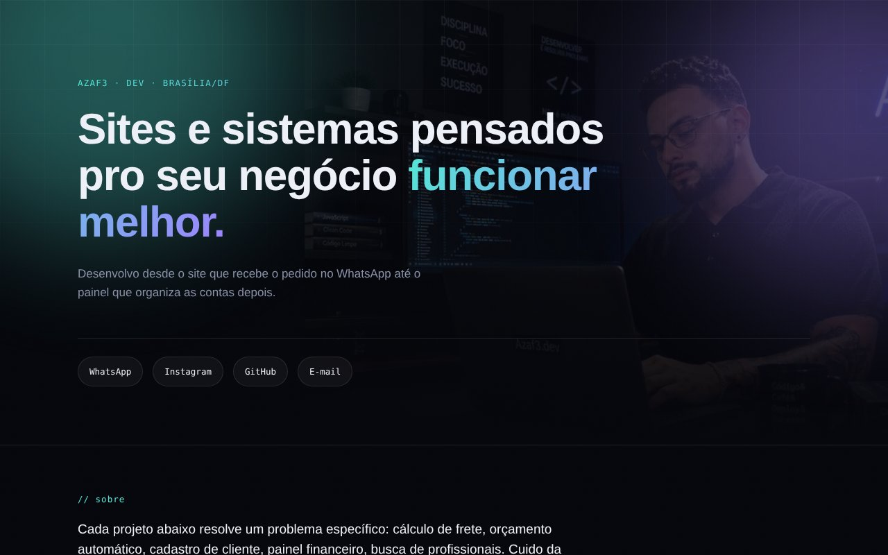

# Portfólio · Azaf3

Meu portfólio: sites, sistemas e apps que estão em uso de verdade, com o problema que cada um resolve e a stack usada.

🔗 **No ar:** https://azaf3.github.io/portfolio/

## Projetos apresentados

- **ABA Alimentos e Distribuição:** sistema de pedidos com frete por CEP, orçamento em PDF e envio pelo WhatsApp
- **Clínica Prevenire:** site institucional em React
- **Instituto Evolutivo de Educação:** catálogo de cursos em React
- **Acolhe+:** app de saúde mental em React Native + Expo, com API em Node.js

## Stack

HTML, CSS e JavaScript puro num arquivo só, sem framework e sem build. Publicado no GitHub Pages, com imagem de prévia (Open Graph) pra quando o link é compartilhado.
